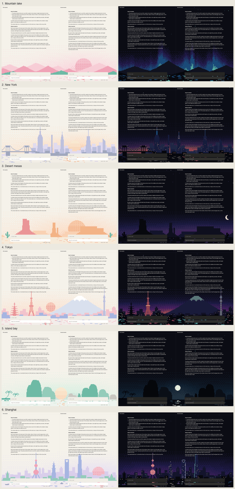

# aurora-dawn

A backdrop for the Claude desktop app in chunky ordered-dither pixel art. Six
scenes take turns behind the chat, five minutes each: Mountain lake, New York,
Desert mesas, Tokyo, Island bay and Shanghai. Every scene has a picture for
light mode and one for dark, and follows whichever the app is in.

The art keeps to the lower part of the window, because the chat text sits
straight on the backdrop: nothing is drawn in the upper third, only a faint
haze and the odd thin tower reach the middle, and the bright parts stay low.

## Install

It is a Claude Code mod. At the prompt of a Claude Code terminal session:

    /plugin install aurora-dawn --marketplace faiqhilman13/aurora-dawn

Answer `y` to add the marketplace, then pick a scope. Or from a shell:

    claude plugin install aurora-dawn --marketplace faiqhilman13/aurora-dawn

Then start a new session in the desktop app's Code tab and send a message: the
backdrop appears with it. It needs Claude Code 2.1.323 or later and a version
of the desktop app that draws a mod's backdrop. The terminal draws none.

## Using it

- `/scene` lists the scenes and says which is showing.
- `/scene next` moves on to the next one.
- `/scene tokyo` (any scene's name) stays on that scene, in every session.
- `/scene auto` lets them take turns again.

## Changing it

The switches are at the top of `hooks/register.tsx`: `MINUTES_PER_SCENE`, and
`VEIL` (how much of the app's own panel colour lies over the picture under the
message box and cards).

Each scene is a small Python file, `tools/scene_<name>.py`, drawn with the kit
in `tools/dither.py` (Python 3 with numpy; Pillow and Chrome for the previews).

    python3 tools/look.py scene_tokyo /tmp/look   # one scene in a mock of the window
    python3 tools/sheet.py /tmp/look              # every scene, light beside dark
    python3 tools/build.py                        # all of them, into hooks/scenes.js
    claude plugin test .                          # the theme's tests

To add a scene, write another `tools/scene_<name>.py` giving `ID`, `NAME`,
`day()` and `night()`, add its name to `ORDER` in `tools/build.py`, and build.

## License

MIT. The scenes are original drawings.
